<div align="center">



<br/>

<a href="https://websiteportofoliokelompok5.vercel.app/"></a>
<a href="https://vassellenhaatthayya.atlassian.net/jira/software/projects/RVN/boards/3/backlog"></a>


<br/>

**[Brief](#brief)** &nbsp;·&nbsp; **[Requirements](#requirements)** &nbsp;·&nbsp; **[Tim](#tim)** &nbsp;·&nbsp; **[Milestone](#milestone)** &nbsp;·&nbsp; **[Jadwal](#jadwal)** &nbsp;·&nbsp; **[Alur Kerja](#alur-kerja)** &nbsp;·&nbsp; **[Quick Start](#quick-start)**

<br/>



</div>

> **Raven Project** adalah Tugas Besar Pengembangan UI (MK UI Lanjut) Kelompok 5. Periode pengerjaan **5 - 26 November 2026**.
> Project Manager: **Evan**. Tools: **GitHub Project**.



<a id="brief"></a>



<details>
<summary><b>📄 Versi teks: Project Brief</b></summary>

<br/>

| Bagian | Isi |
|---|---|
| **Goal** | Membantu pengunjung mengenali Kelompok 5 beserta karya, anggota, dan pencapaiannya melalui website portofolio. |
| **Users** | Dosen, calon pemberi kerja atau klien, dan pengunjung umum yang ingin menilai kemampuan tim. |
| **Kebutuhan** | Memahami profil tim dan anggota, melihat bukti karya beserta kontribusi, dan menemukan pencapaian dengan mudah. |
| **Luaran** | Prototype HTML + CSS lima halaman (Homepage, Projects, Team, Achievements, About), responsif, konsisten secara visual, dan telah diuji dengan SUS. |
| **Indikator keberhasilan** | Semua anggota memiliki profil; setiap project menjelaskan kontribusi; semua halaman dapat dinavigasi; skor SUS rata-rata mencapai target NFR-03. |
| **Scope** | **Dikerjakan:** desain UI, prototype HTML + CSS, uji SUS, perbaikan. **Tidak dikerjakan:** transaksi atau fitur di luar lima halaman. |

</details>


<a id="requirements"></a>



<details>
<summary><b>📄 Versi teks: Requirements dan Kriteria Penerimaan</b></summary>

<br/>

**Functional Requirements**

| ID | Requirement | Kriteria penerimaan |
|---|---|---|
| FR-01 | Pengunjung dapat melihat ringkasan tim dan berpindah ke halaman lain dari Homepage. | Ringkasan tim tampil; navigasi ke Projects, Team, Achievements, dan About berfungsi. |
| FR-02 | Pengunjung dapat melihat daftar project dan membuka detail project. | Tiap project memuat judul, deskripsi, dan kontribusi; klik project membuka detail yang benar. |
| FR-03 | Pengunjung dapat melihat profil setiap anggota. | Setiap anggota memiliki nama, kompetensi, dan ringkasan profil; detail anggota dapat dibuka. |
| FR-04 | Pengunjung dapat melihat pencapaian tim. | Tiap pencapaian memuat judul, tahun, dan deskripsi. |
| FR-05 | Pengunjung dapat memahami latar belakang dan tujuan tim di About Us. | Halaman memuat tujuan dan latar belakang tim. |

**Non-Functional Requirements**

| ID | Requirement | Kriteria penerimaan |
|---|---|---|
| NFR-01 | Layout tetap dapat digunakan pada layar kecil dan besar. | Pada ukuran layar yang disepakati, konten utama tidak terpotong dan tidak ada horizontal overflow. |
| NFR-02 | Tampilan konsisten antarhalaman. | Warna, tipografi, dan komponen mengikuti style dasar yang sama pada semua halaman. |
| NFR-03 | Prototype mudah digunakan. | Skor SUS rata-rata minimal 68 dari 20 responden. |

</details>


<a id="tim"></a>



<details>
<summary><b>📄 Versi teks: Tim dan Tanggung Jawab</b></summary>

<br/>

| Anggota | Peran | Tanggung jawab utama |
|---|---|---|
| **Evan** | Project Manager | Arah produk dan prioritas; koordinasi dan tindak lanjut hambatan; mengelola GitHub Project dan README; memimpin meeting dan notulen; status update; koordinator dan rekap uji SUS; dokumentasi dan laporan; menguji 5 responden. |
| **Rizky** | PIC UI dan prototype | Homepage dan Projects/Project Detail (UI, prototype, perbaikan); menjaga konsistensi UI dan konten. |
| **Vassel** | PIC UI dan prototype | Team/Member Profile dan Achievements (UI, prototype, perbaikan); menjaga integrasi dan pemeriksaan pull request. |
| **Raka** | PIC UI dan prototype | Achievements dan About Us (UI, prototype, perbaikan). |

Satu orang boleh memegang beberapa tanggung jawab, dan semua anggota tetap berkontribusi pada produk.

</details>


<a id="milestone"></a>



<sub>Status sprint pada visual di atas: per 16 November 2026.</sub>

<details>
<summary><b>📄 Versi teks: Milestone dan Sprint Goal</b></summary>

<br/>

| Sprint | Periode | Sprint goal | Milestone | Review, retrospective, planning |
|---|---|---|---|---|
| **Sprint 1** | 5 - 12 Nov | Desain UI seluruh halaman selesai dan tervalidasi. | **M1:** Struktur utama dan alur halaman tervalidasi (12 Nov) | Review pada weekly meeting 12 Nov; retrospective dan planning pada meeting 13 Nov |
| **Sprint 2** | 13 - 18 Nov | Prototype HTML + CSS seluruh halaman dapat dinavigasi dan telah diuji SUS oleh 20 responden. | **M2:** Fitur dan konten utama terintegrasi (18 Nov) | Review, retrospective, dan planning pada asistensi Kamis 19 Nov |
| **Sprint 3** | 19 - 26 Nov | Temuan SUS diperbaiki, hasil terintegrasi, dan siap dipresentasikan. | **M3:** Testing/evaluasi, perbaikan, dan persiapan presentasi (26 Nov) | Review dan retrospective pada Kamis 26 Nov |

</details>


<a id="jadwal"></a>



<details>
<summary><b>📄 Versi teks: Jadwal Koordinasi</b></summary>

<br/>

| Kegiatan | Jadwal | Isi |
|---|---|---|
| Check-in singkat via chat | Minimal 2 kali seminggu | Progress, rencana terdekat, dan hambatan |
| Weekly meeting | Kamis: 12, 19, dan 26 Nov | Validasi hasil, review, dan tindak lanjut; blok 60 - 90 menit dengan calendar event untuk semua anggota |
| Review, retrospective, planning | Akhir tiap sprint | Periksa dan tunjukkan hasil, evaluasi cara kerja, rencanakan sprint berikutnya |
| Status update | Mingguan (#1 18 Nov, #2 25 Nov) | Tanggal dan anggota hadir; Progress; Planning; Problem; Keputusan/tindak lanjut dan target waktunya |

</details>


<a id="alur-kerja"></a>



<details>
<summary><b>📄 Versi teks: Alur Kerja, Arti Status, Fields dan Views</b></summary>

<br/>

1. Setiap pekerjaan dicatat sebagai **issue** (assignee, priority, size, iteration, status).
2. Buat **branch** dari issue, lalu kerjakan perubahan.
3. Buka **pull request**: tulis apa yang berubah, issue terkait, dan cara memeriksa.
4. Anggota lain melakukan **review**, lalu **merge**.

> Membuka pull request belum berarti task selesai.

| Status | Arti |
|---|---|
| Todo | Direncanakan, belum dikerjakan |
| In Progress | Sedang dikerjakan |
| In Review | Hasil tersedia dan menunggu pemeriksaan |
| Done | Kriteria penerimaan terpenuhi dan hasil telah diperiksa; perubahan kode terintegrasi jika relevan |

- **Fields:** Status, Assignees, Priority (High, Medium, Low), Size (S, M, L), Story Points (Fibonacci), Iteration (Sprint 1 sampai 3).
- **Views:** Backlog (table) dan Current Sprint (board).

</details>


<a id="quick-start"></a>

## ⚡ Quick Start

Situs ini statis (HTML + CSS + JS, tanpa build). Gambar disimpan dengan **Git LFS**, jadi pastikan `git lfs` terpasang sebelum clone.

```bash
git clone https://github.com/Rizksan28/proyek-raven-kelompok-5.git
cd proyek-raven-kelompok-5
git lfs install

# kerjakan dari Fitur-Project, bukan main
git fetch --all
git checkout Fitur-Project
git pull
git lfs pull

# jalankan dari root repo (path aset root-absolut, jangan buka lewat file://)
npx serve -l 3000
```

Buka `http://localhost:3000`. Kalau gambar tampil kosong atau rusak, jalankan `git lfs pull` sekali lagi.

### 🌿 Aturan branch

| ✅ Lakukan | ❌ Jangan |
|---|---|
| Buat branch kerja dari `Fitur-Project`, satu branch per issue (contoh: `fitur/about-us`) | Coding atau commit langsung ke `main` |
| Buka pull request dengan base **`Fitur-Project`** | Commit langsung ke `Fitur-Project` |
| Minta review anggota lain sebelum merge | Mengubah branch milik anggota lain |
| `git fetch --all` dan `git pull` sebelum mulai dan sebelum push | `push --force` atau `reset --hard` di branch bersama |

### 🎨 Design tokens

| Token | Nilai | Pemakaian |
|---|---|---|
| `--ink` | `#0b0708` | Latar utama |
| `--burgundy` | `#19090b` | Panel dan kartu |
| `--red` / `--bright-red` | `#a30e16` / `#d21f27` | Aksen, tombol, garis aktif |
| `--gold` | `#b58b62` | Eyebrow, label, garis tipis |
| `--ivory` / `--muted` | `#f2e9e2` / `#c8b6ad` | Teks utama / teks sekunder |
| Font | Bebas Neue · Cormorant Garamond · Manrope | Judul · aksen italic · teks isi |

<br/>

<div align="center">



<sub>Visual README dibuat sebagai SVG beranimasi di <code>assets/readme/</code>. Animasi berhenti otomatis bila perangkat memakai pengaturan <i>reduce motion</i>.</sub>

</div>
